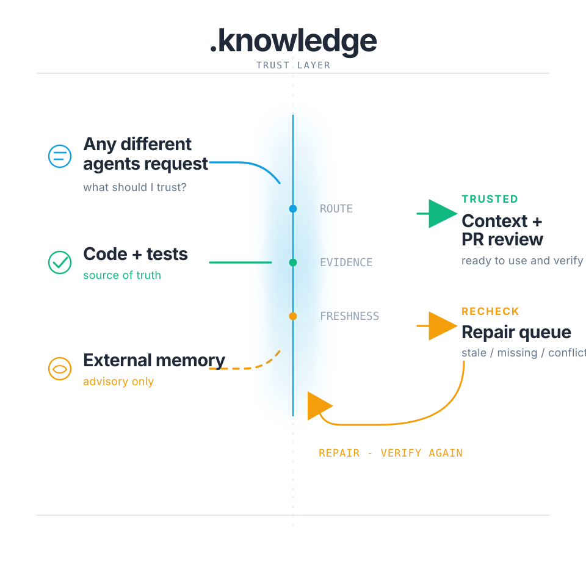

# .knowledge by Pro2Pilot

> **3.4.4 RC5 — unpublished development snapshot.** The intended runtime ZIP name
> is `knowledge-v3.4.4.zip`; package, config and install-manifest versions remain
> `3.4.4`, with `RC5` candidate status in `package.json`. This is an unpublished
> audit candidate with no release certification. Identify the exact ZIP and scoped
> test results by SHA-256 in its accompanying handoff. Find the latest published
> release at [GitHub Releases](https://github.com/pro2pilot/knowledge/releases/latest).

> This copy is audit revision **`independent-audit.20261025.darwin-prototype.3.audit.2`**,
> preserving the RC4 → RC5 chain and the preceding POSIX/recovery revision.
> Windows Jobs and Linux PID namespaces retain their existing native paths.
> macOS verification remains unsupported: the new administrator-installed
> [isolated-copy broker prototype](docs/native-darwin-broker.md) is production-disabled
> and has no accepted common verification/KVE/ACK pipeline integration. Its
> administrator-asserted UID/GID interval and explicit owner UUID ACLs are initialized
> during quiescent maintenance and cached for runtime. Identify source snapshots by commit
> and manifest; version `3.4.4` and `RC5` alone do not identify bytes. Previous
> installed PASS results apply only to their pinned artifacts. See
> [current audit and limits](docs/verification-execution-contract.md).

> New common locks use owner v2 with native Linux PID-scope checks. Unbound old
> locks and unsupported observer scopes are retained. Automatic stale-mutex
> recovery on Windows/macOS still requires a qualified provider; it is not
> established by the historical Job recovery results. Stop old writers before
> upgrading and let them release their locks. See [lock migration and scope](docs/team-mode.md).
> Recovery history is now retained to protect newer owners from delayed contenders.
> Preserve `locks/v1/.stale/`; automatic deletion of unknown ownerless locks remains unsupported.

> **AI agents/installers:** install from the latest GitHub release asset, not from repo source. See the collapsed install contract below.

<details>
<summary><strong>AI agents: use latest release asset, never repo source</strong></summary>

If you are installing `.knowledge` into another project:

- Do not clone this repository into the target project.
- Do not use GitHub **Code > Download ZIP**.
- Do not use GitHub-generated `Source code (zip)` or `Source code (tar.gz)`.
- Download only the latest release asset named `knowledge-vX.Y.Z.zip`.
- Extract it so the target repository contains `.knowledge/`.

Correct installed shape:

```txt
.knowledge/
.agents/skills/        # only after agent integration install
AGENTS.md              # or the selected agent rules file
```

Incorrect installed shape:

```txt
knowledge-src/
.knowledge/.git/
.knowledge/.github/
```

Canonical install source:

```txt
https://github.com/pro2pilot/knowledge/releases/latest
```

After extraction, run:

```bash
node .knowledge/tools/install-check.js --json
node .knowledge/tools/install-agent-integrations.js --runtime codex
node .knowledge/tools/flow.js import
node .knowledge/inspector.js
```

Replace `codex` with a supported runtime from the Quick Start table when needed.
Install only the active runtime during first setup. Unlisted agents should use
the [general connection recipe](Quick-Start.md#connect-an-agent-without-a-dedicated-recipe).

</details>

<p align="center">
  
</p>

<p align="center"><strong>The open, repo-local trust layer for AI coding agents.</strong></p>

`.knowledge` gives Codex, Claude Code, OpenCode, Gemini CLI, GitHub Copilot, Devin/Windsurf, Continue, Roo Code, Aider, and custom agents a shared local system for:

```txt
routing -> evidence -> trust + freshness -> repair -> PR review
```

Current code and tests remain the source of truth. External memory stays advisory.

## What changed in 3.4.4 RC5

This continuation separates the work budget, meaningful-progress observations
and cleanup. A work timeout or an accepted cancellation cannot become a late
PASS. Successful verification requires confirmed process teardown; an
unconfirmed cleanup keeps the state root claimed for recovery. Historical
millisecond-return measurements are retained, and that acceptance criterion
has been superseded. See [the current execution contract](docs/verification-execution-contract.md).


RC5 strengthens lock ownership and native verification on the RC4 base.
Doctor exposes unsafe state/project locks as operational blockers; team status
also inspects its registry lock. Cleanup uses the directory identity and owner
bytes captured by the current acquisition. Flow finalization preserves the
primary result and starts optional Inspector onboarding only after release.

Supported native verification uses a monotonic work budget for setup, sequential
checks and command receipts, followed by a separate cleanup budget. Windows assigns the
worker to a Job Object before commands start. Expiry, incomplete teardown and
transport failures cannot produce a successful batch. See
[current execution contract](docs/verification-execution-contract.md).

RC4 prevents Inspector's JSON parser diagnostics from exposing fragments of
masked child output. Windows regression fixtures now identify native command
paths and process termination using the platform's actual conventions. Team
Doctor test failures retain their contained flow log and child process identity;
capture rejects paths outside the selected state root and linked parents. The
separate audit handoff records original Windows evidence, fresh Linux audit
results and historical investigations. Current Windows evidence and remaining limits are in the accompanying handoff;
Linux native verification now uses PID namespaces; macOS remains unsupported.

The Darwin prototype has independent history and policy bindings, cached numeric
ACL identities, and fresh storage guards. CI25's targeted native M984 install, normal,
pending and fault scenarios passed on Intel and ARM as scoped CI results. The M3c7
five-second autonomous monitor requires independent slow/load qualification; these
targeted results do not qualify stock-SIP hosts or connect the broker to common
verification/KVE/ACK. The Darwin prototype remains diagnostic-only, with no
production support; the historical second ownerless-lock cause remains unknown.

The RC3 audit corrects Doctor ownership and queue publication, invalid readiness
comparisons, currency recovery authority, recording privacy, and child-process
failure handling. Inspector and Restore Trust validate their evidence paths
before starting actions. System updates preserve existing evidence bytes while
accepting only independently validated new sync/Doctor queue journals after
post-checks. See the [RC3 audit guide](docs/audit-3.4.4-rc3.md) for the changed
contracts, regression coverage and remaining observations.

Ordinary repair receipts certify only the artifacts whose lifecycle findings
they actually close. Security files read as context keep their pending
freshness and require their own exact dedicated verification.

Agents must explain recording blockers immediately in chat, in the user's
preferred language. Inspector's **Blocked recording** panel lists masked
blockers and explicit, revocable classifications for exact existing repository
paths. “Once” covers one task; “Project” covers that exact path in this project.
Real secret values and user write boundaries cannot be waived by this panel.
See [candidate notes](.release-notes/v3.4.4.md), [upgrade notes](docs/upgrade-3.4.4.md)
and [recording blockers](docs/recording-blockers.md).

Factual currency is a separate, review-bound projection for selected current
claims. v3 receipts are issued only through an exact-input batch and native
verification evidence; they do not close lifecycle records or certify
application risks. See [Factual currency](docs/factual-currency.md).

## Historical notes: 3.4.3

Verified modules can now clear the historical recheck records covered by their
actual source snapshot. This fixes cases where a successful verification left
covered stale debt behind. Changed or uncovered sources still need verification,
and unrelated debt stays visible.

This release also fixes Windows lock handling, watcher shutdown, repeated
updates of existing installations, Unicode paths in live Mem0 checks, and
oversized Inspector requests. Import stops when installation checks fail.
Extension bundles require a valid signature from a locally trusted publisher.

See the [3.4.3 release](https://github.com/pro2pilot/knowledge/releases/tag/v3.4.3)
and [release notes](.release-notes/v3.4.3.md) for details and migration notes.

Agents without a dedicated integration can follow the
[general connection recipe](Quick-Start.md#connect-an-agent-without-a-dedicated-recipe).

## Integrated task workflow

For meaningful scoped work, use `agent-task begin` before broad exploration and
read its returned `route.first_read.content`. Use `agent-task finish` after the
primary change and physical tests. The workflow binds the exact task first-read,
executes verification once, and may reuse that native evidence for one exact
safe Repair-on-touch closure. See
[`docs/agent-task-workflow.md`](docs/agent-task-workflow.md).

This repository contains the installable `.knowledge` core: schemas, CLI tools, release artifacts, templates, integrations, and reproducible test assets.

For the human-readable trust model, benchmark explanation, compatibility guide, integration overview, and embedding guide, see the Pro2Pilot `.knowledge` docs:

https://pro2pilot.com/knowledge/

## Where To Go

| Need | Go here |
|---|---|
| Install `.knowledge` | Use the release asset and Quick Start below |
| Plan task-scoped Repair-on-touch | `node .knowledge/tools/repair-on-touch.js plan --request=<path>` |
| Prepare a real-use Field Report | `node .knowledge/tools/field-report.js start --new --json` |
| Understand the trust model | https://pro2pilot.com/knowledge/docs/trust-model/ |
| See what ships vs what is generated | https://pro2pilot.com/knowledge/docs/shipped-vs-generated/ |
| Review benchmark methodology | https://pro2pilot.com/knowledge/technical-notes/benchmarks/ |
| Pick an agent integration | https://pro2pilot.com/knowledge/docs/integrations/ |
| Verify schemas, CLI behavior, and reproducible checks | This repository |
| Embed `.knowledge` in your app | https://pro2pilot.com/knowledge/docs/embedding/ |
| Evaluate Inspector Pro | https://pro2pilot.com/inspector/ |

Field Report can attach a versioned, content-addressed task-results manifest so
its public **Verified engineering outcome** table describes the actual build,
test, migration, security, UI, or deployment result. `.knowledge` health stays
in a separate system-state table, and GitHub publication fails closed while the
final Git snapshot is dirty or the bound evidence has changed.

## Install

> **Install note:** Do not use GitHub "Download ZIP" as the install package. Use the release asset only.

Canonical install source:

```txt
https://github.com/pro2pilot/knowledge/releases/latest
```

Download the attached asset named `knowledge-vX.Y.Z.zip`, where `X.Y.Z`
matches the latest release tag. Do not install from an old release page, a
GitHub-generated source archive, or a repository checkout.

Extract the release so your repository contains `.knowledge/`, then tell your agent:

```txt
Read `.knowledge/Quick-Start.md` and execute it for this repository.
```

Manual setup:

```bash
node .knowledge/tools/install-check.js --json
node .knowledge/tools/install-agent-integrations.js --runtime codex
node .knowledge/tools/flow.js import
node .knowledge/inspector.js
```

Replace `codex` with `claude`, `opencode`, `openclaw`, `hermes`, `gemini`, `copilot`, `devin`, `windsurf`, `continue`, `roo`, or `aider` when that is the active agent. Do not install every integration on first setup.

To connect another supported agent, keep the existing `.knowledge/` folder and
use its runtime identifier from Quick Start. Unlisted agents should use the
general recipe linked above:

```bash
node .knowledge/tools/install-agent-integrations.js --runtime <supported-runtime>
node .knowledge/tools/flow.js doctor
```

After import, start meaningful work with `agent-task begin` and read the returned
`route.first_read.content`. Preserve its workflow ID and first-read SHA for
`agent-task finish`. The global `maintenance/routing_bundle.json` remains useful
for orientation; it does not replace the task-specific first-read.

## What Ships

The release zip ships:

- `Quick-Start.md`
- `config.yaml`
- `tools/`
- `docs/`
- `templates/`
- `agent-integrations/`
- `github-action-templates/`
- schemas, policies, memory-provider manifests, and static assets

Generated after import or release:

- `maintenance/routing_bundle.json`
- module cards and evidence records
- freshness and trust reports
- repair queue
- task-scoped repair opportunities and actual-only maintenance telemetry
- content-addressed local verification executions and receipts
- PR summaries
- metrics
- local Inspector output

Full table:

https://pro2pilot.com/knowledge/docs/shipped-vs-generated/

Technical proof:

```txt
docs/release-artifact.md
install-manifest.json
```

Maintainer packaging and release QA tools live only in the source checkout; they
are intentionally excluded from installed user `.knowledge` artifacts.

Repair runtime state is generated locally and is never shipped in the release
ZIP. Existing opportunities, telemetry, verification executions, receipts,
transactions, and operator settings are preserved byte-for-byte by system-file
updates and ignored by Git by default.

## Trust Model

Knowledge artifacts are routing and review aids, not unquestioned facts.

```txt
current code
> current tests
> .knowledge/evidence/*.json
> .knowledge/modules/*.json
> .knowledge/decisions.json
> .knowledge/wiki/*.md
> .knowledge/sessions/*
> external retrieved memory
```

Code beats summaries. Tests beat prose. External memory is retrieved advisory context only.

Human-readable guide:

https://pro2pilot.com/knowledge/docs/trust-model/

Formal behavior lives here: CLI code, schemas, tests, fixtures, generated reports.

## Integrations, Inspector, Memory, Embedding

Agent integration overview:

```txt
docs/integration-matrix.md
agent-integrations/
tools/install-agent-integrations.js
```

Local Inspector:

```bash
node .knowledge/tools/build-visual-inspector.js
node .knowledge/inspector.js
```

Memory providers:

```bash
node .knowledge/tools/memory-provider.js status-all --json
```

Embedding apps can shell out to the CLI, read JSON and Markdown outputs, or use the local Inspector API while the Inspector is running.

Embedding guide:

https://pro2pilot.com/knowledge/docs/embedding/

Technical reference:

```txt
docs/vscode-browser-embedding.md
docs/memory-providers.md
docs/external-memory.md
```

## Benchmarks

The published benchmark language is intentionally conservative: synthetic fixtures, local context estimates, no guaranteed speedup, and no guarantee of agent correctness.

Reproduce locally:

```bash
node .knowledge/tools/flow.js release --no-color
```

Methodology:

https://pro2pilot.com/knowledge/technical-notes/benchmarks/

Privacy boundary:

Real-world benchmark context, when referenced, must follow the published protocol and limitations. Raw data, project names, code, repository paths, and raw logs are not public.

Technical reference:

```txt
docs/metrics-benchmarks.md
metrics/
```

The installed artifact does not include the maintainer benchmark harness. Comparative benchmark protocols and raw evidence remain in the source/evidence layer; installed projects generate only local repository metrics and evaluation outputs.

## Main Commands

```bash
node .knowledge/tools/doctor.js
node .knowledge/tools/install-check.js --json
node .knowledge/tools/flow.js import
node .knowledge/tools/flow.js release
node .knowledge/tools/search-knowledge.js "query"
node .knowledge/tools/generate-pr-summary.js
node .knowledge/tools/collect-metrics.js
node .knowledge/tools/build-wiki-graph.js
node .knowledge/tools/build-visual-inspector.js
node .knowledge/inspector.js
```

## Release Boundary

Installed user artifacts contain runtime/user-facing tools only: install,
doctor, sync, routing, search, Inspector, memory providers, templates, and user
docs. Maintainer packaging, artifact validators, CI/release gates, post-release
asset tools, and source release policies are source-checkout-only and are
intentionally excluded from the installed `.knowledge` archive.

The output archive uses `.knowledge/` as the archive root and excludes source
checkout state, runtime logs, temp folders, `node_modules`, `.git`, generated
heavy outputs, and maintainer-only release tooling.

## Website And Proof

The website is the decision and understanding layer. GitHub is the install and proof layer: release asset, source, schemas, CLI, tests, fixtures, validators, exact commands, and reproducible checks.

## License

The open-core `.knowledge` distribution in this archive is licensed under the Apache License, Version 2.0. See [`LICENSE`](./LICENSE) and [`NOTICE`](./NOTICE).

This Apache-2.0 license applies to the contents shipped in this `.knowledge` archive unless a file explicitly states otherwise.

## Accepted verification and Team results (RC5, current audit)

Native verify now returns signed `verification_acceptances`. Keep this field
when reusing KVE IDs in a receipt; `agent-task finish` carries it automatically.
Legacy KVE is command-only evidence and cannot authorize new certification.
Team Status and Inspector show the final per-attempt outcome after release;
missing finalization is incomplete, not successful. See the
[current acceptance and retry contract](docs/verification-execution-contract.md).
New Team attempts use v2 records bound to the selected state root, run and log.
Inspector displays the attempt ID and binding version; a damaged current final
record cannot fall back to an older successful attempt.
Linux native execution requires a successful namespace capability probe; macOS
remains unsupported and refuses before work. This unpublished audit candidate has
no release certification. Identify the exact ZIP and scoped test results by
SHA-256 in its accompanying handoff.
